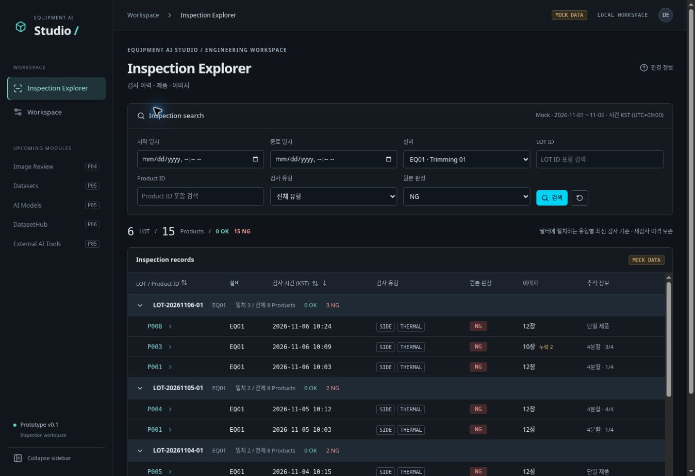

# Phase 2 — Inspection Explorer 검증

2026-11-05. Phase 1 기반 위의 검색/계층형 목록 단계입니다. Viewer 구현은 포함하지 않습니다.

## 구현

- 결정적 Mock: 설비 9대, LOT 54개, 제품 432개. SIDE/THERMAL, 4분할, 재검사, 이미지 누락 포함.
- 설비/LOT/Product/유형/판정/기간 복합 검색. KST 입력·표시, UTC 조회 계약.
- LOT 펼치기·접기, 시간/제품 ID 정렬, LOT 단위 페이징, 조회 결과 집계.
- 제품 상세 진입은 고유 제품 키로 연결. URL에 조건을 보존해 새로고침과 목록 복귀 지원.
- 서버 전환은 InspectionRepository 경계 유지. 현재 페이지 외 제품을 화면이 직접 조회하지 않음.

## 결과

[Windows CI 41977285836](https://github.com/WithMK/EquipmentAIStudio/actions/runs/41977285836) 성공. 검증 코드 커밋 `5c1f280ae174fcc1ed13758aaa71044c4c946770`.

- TypeScript strict 검사, 모듈 경계 검사, production build 통과.
- 단위 테스트 14개: Phase 1 회귀 및 복합 필터/최신 재검 판정/누락/LOT 페이지/정렬/URL/시간대/고유 키/취소 검증.
- Chromium E2E: 루트 8개 + `/studio/` 8개 통과. 1920×1080 및 1440×900에서 검색/접기/정렬/페이지/상세·복귀/새로고침/빈 결과/잘못된 기간/404/가로 넘침 검증.
- Cloud Chrome 수동: EQ01+NG 검색 후 상세 이동·목록 복귀 확인.

첫 E2E에서 필터의 label 선택이 모호하여 명시적 aria-label을 추가한 뒤 전체 CI를 통과했습니다.

## 제한

Mock 메타데이터만 사용합니다. 실제 API/DB, 이미지 파일·Viewer·리뷰 저장은 미구현입니다. 원본 판정과 검토 데이터는 계속 분리됩니다. 화면 표는 현재 HTML table이며 대형 LOT 자식 페이징/가상화는 실제 데이터 규모에 맞춰 후속 적용합니다. 정렬은 LOT 내부 제품과 각 LOT 첫 제품의 정렬값에 적용됩니다. LOT가 페이지 경계에서 분할되지 않습니다.

