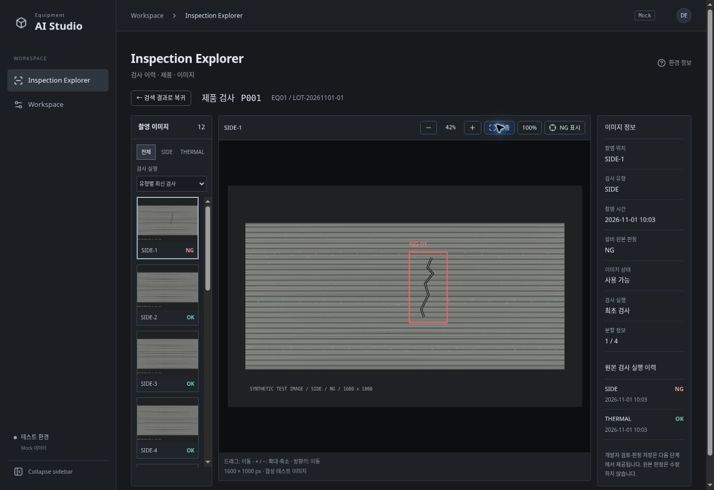

# Phase 3 — Product Image Viewer

2026-11-05. Phase 2 기반. Review 저장은 Phase 4로 유지합니다.

## 구현

- SIDE/THERMAL 및 검사 실행별 이미지·재검사 선택, 썸네일, 최신 검사 NG 이미지 우선 선택
- 5~800% 확대/축소, 화면 맞춤/100%, pointer capture 기반 드래그, 방향키 이동
- NG 영역을 원본 픽셀 좌표로 이미지와 함께 변환. 보정 정보가 없으므로 µm/온도 실측값은 표시하지 않음
- 이미지 전환 시 맞춤 초기화, ResizeObserver 기반 크기 조정, 누락/대기/로딩/실패 표시
- 기존 검색 조건을 보존한 목록 복귀
- 반복 브랜드/예정 기능 목록/단계 배지를 줄이고 중성 회색·얇은 경계·판정 색상 중심으로 UI 정리

Mock adapter가 이미지 URL·크기·NG 영역을 제공하며 Viewer는 fixture를 직접 참조하지 않습니다. samples 폴더의 SVG 4개는 검사 패턴 시연용 합성 자료이며 실제 설비 영상이 아닙니다. 일부 촬영 위치는 패턴을 재사용합니다.

## 검증

[Windows CI 41978559451](https://github.com/WithMK/EquipmentAIStudio/actions/runs/41978559451) 성공. 코드 커밋 bb8e762faa9b2a66a91215b84d03edde132d779f.

- TypeScript strict, 모듈 의존성 검사, production build
- 단위 17개: 기존 회귀, fit/scale 경계, 유형별 최신 실행, NG 이미지 계약/누락 보존
- E2E root 12개 + /studio/ 12개: 1920×1080 및 1440×900. 기존 검색/복귀/새로고침 외에 NG 기본 선택, 확대, 100%, 실제 마우스 드래그, fit, 오버레이 숨김, 유형/재검 전환, 누락 복구 선택, 요청 실패 처리
- Cloud Chrome에서 원본 크기/이동/맞춤과 디자인 확인

## 범위와 제한

개발자 판정/불량 유형/메모 저장, 다중 이미지 동시 비교, 실제 TIFF 디코딩/대형 이미지 타일 스트리밍, 실제 설비/API 연결은 아직 구현하지 않습니다. 실제 서비스 adapter는 브라우저 표시 가능한 URL 및 정확한 원본 크기·좌표를 제공해야 합니다.

