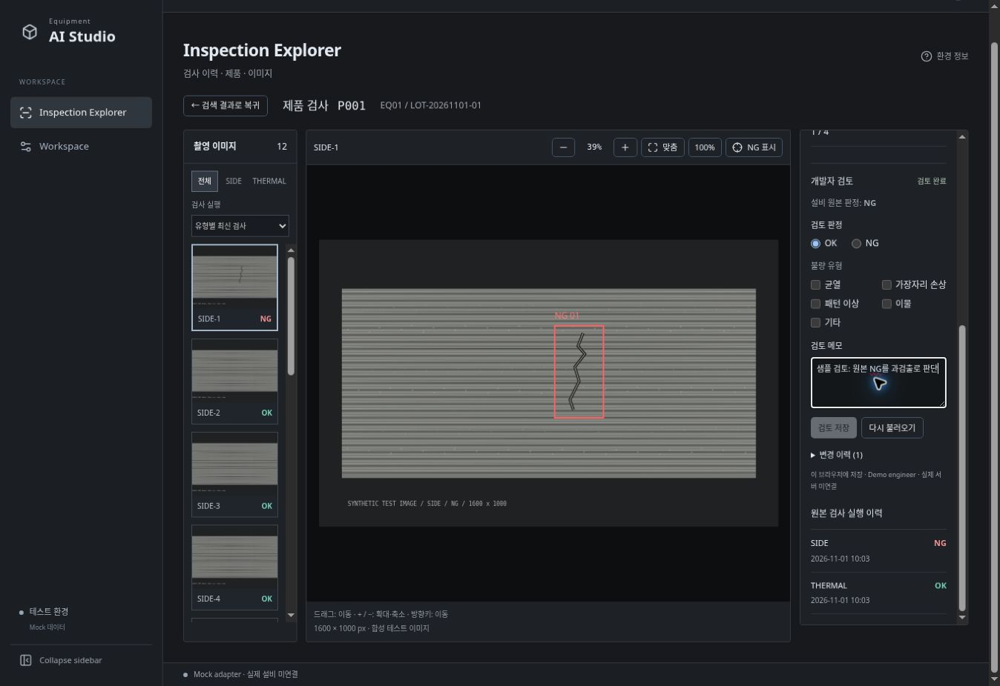

# Phase 4 — Image Review

## 구현

설비 원본 판정을 유지하면서 이미지별 개발자 OK/NG, 불량 유형, 메모를 별도로 저장한다. 기존 Phase 3 Viewer의 오른쪽 패널과 공통 테마를 재사용한다. 검토 완료/미검토 상태와 변경 이력을 표시하며, 누락 이미지는 검토를 저장할 수 없다.

- `ReviewRepository` 계약으로 저장소와 UI 분리. Mock adapter는 IndexedDB 사용.
- 이미지 단위 readwrite 트랜잭션에서 예상 revision을 비교하고 이력을 추가한다. 다른 탭의 변경을 덮어쓰지 않으며 충돌 시 초안을 유지한다.
- 저장 완료는 transaction 완료 후 표시한다. NG에는 불량 유형이 필요하며 OK에는 불량 유형을 저장하지 않는다.
- 이미지/검사 선택 변경, 라우트 이동, 페이지 종료에서 미저장 변경을 확인한다.
- 공통 `ReviewSlot`과 composition root 주입으로 Inspection Explorer와 Image Review의 직접 의존을 방지한다.
- HTTP 개발 호스트에서도 지원하는 `crypto.getRandomValues`로 revision ID 생성.

## 검증

코드 커밋: `e394f176921cbf0b8ab1f6d72439196f692f2ee9`

- 로컬 TypeScript, 모듈 경계 검사, production build 성공.
- 단위 테스트 21개 통과: 기존 회귀, 저장/다시 조회, 이력 연결, 동시 수정 충돌, 잘못된 검토·누락 이미지·검토자 검증, HTTP 환경 ID 생성 포함.
- [Windows CI](https://github.com/WithMK/EquipmentAIStudio/actions/runs/41980282330): 성공. Windows production build, 단위 테스트 21개, E2E `/` 16개 + `/studio/` 16개(총 32개) 통과.
- Playwright는 1920×1080 및 1440×900에서 `/`와 `/studio/` 각각 실행한다. 검토 저장/새로고침, 원본 판정 보존, 변경 이력, 미저장 이동 방지, 다른 탭 충돌 및 다시 불러오기를 기존 Explorer/Viewer 회귀와 함께 검증한다.
- 실제 개발 브라우저에서 원본 NG 이미지에 OK와 메모 저장 후 새로고침하여 검토 완료, 메모, 이력 1건 보존 확인. HTTP 호스트의 randomUUID 미지원 문제를 발견하여 수정하고 회귀 테스트 추가.

## 주요 변경 파일

- `web/src/features/image-review/ReviewPanel.tsx`: 검토 폼, 상태, 이력, 미저장 보호
- `web/src/adapters/mock/reviewRepository.ts`: IndexedDB 저장소, 검증, revision 충돌
- `web/src/shared/services/contracts.ts`, `shared/modules/reviewSlot.tsx`: 계약과 확장 지점
- `web/src/adapters/mock/createMockServices.ts`, `web/src/main.tsx`: 서비스 및 패널 조립
- `web/src/features/inspection-explorer/productEntry.tsx`, `web/src/app/theme.css`: 기존 Viewer 통합
- `web/tests/reviews.test.ts`, `web/e2e/reviews.spec.ts`: 단위 및 브라우저 테스트
- README, 개발 로드맵, Workspace 단계 표시, package manifest/lock

## 제한 및 다음 단계

검토는 현재 브라우저 프로필/사이트 origin의 IndexedDB에 저장된다. 서버 공유, 사용자 인증, 백업은 구현하지 않았다. 브라우저 데이터 삭제나 다른 PC에서는 보존되지 않으며 Demo engineer 신원을 사용한다. 운영에서는 인증된 API adapter 및 서버의 원자적 revision 검증으로 교체해야 한다. 저장 공간 고갈/권한 오류는 UI로 보고하고 입력을 유지하지만 실제 quota 고갈을 자동화로 재현하지는 않았다.

Phase 5 Dataset/Model 관리와 실제 모델 학습·배포는 이번 범위에서 제외한다.
