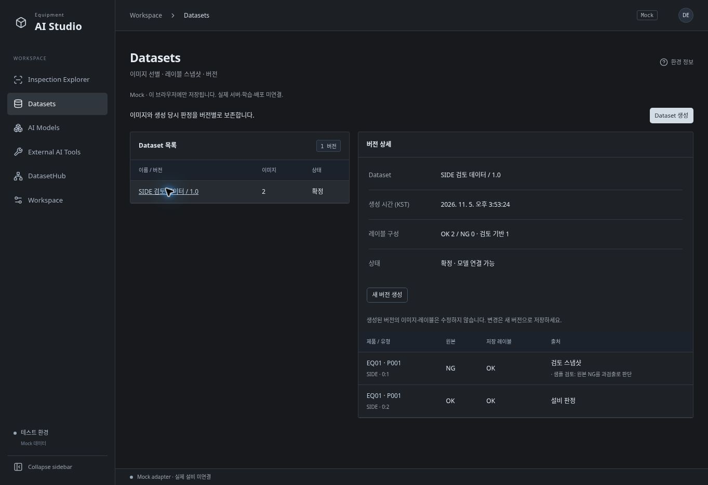
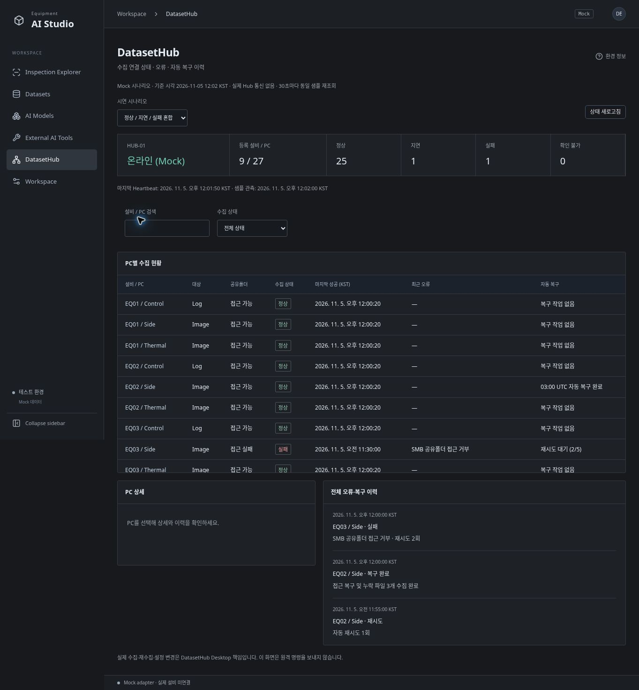

# Phase 5 / 6 — Registry and Hub Prototype

## 구현 범위

| Module | 제공 기능 | 범위 밖 |
|---|---|---|
| Datasets | 이미지 검색/페이지 선택, 생성, 버전 목록/상세, 레이블 스냅샷, 버전 확정 | Export, 이미지 파일 복사, 기존 버전 편집/삭제 |
| AI Models | 버전 등록/검색/상세, 확정 Dataset 연결, 학습일/Accuracy/평가조건/경로/상태 | 실제 모델 파일 검사, 학습, 배포, 기존 버전 편집/삭제 |
| External AI Tools | SAIGE 등 도구 정보 등록/재조회, 버전·경로·메모 | EXE 실행, 학습 제어 |
| DatasetHub | 9개 설비/27개 PC Mock 상태, 검색/필터/상세, 오류/재시도/복구 이력, 3개 시나리오 | 실제 원격 통신 및 수집/재수집 명령 |

UI는 기존 중성 다크 테마와 Shell을 재사용한다. 네 개 모듈은 composition root 등록만으로 메뉴에 연결되고, feature끼리 직접 import하지 않는다. 기존 `Start-Studio.bat` 실행 방식은 유지한다.

## 저장 및 확장

- `shared/domain/management.ts`: 후보, DatasetVersion/Item, ModelVersion, ExternalTool, HubSnapshot 계약.
- `shared/services/contracts.ts`: CatalogRepository 및 HubRepository 주입. UI는 Mock fixture 직접 참조 금지.
- 별도 IndexedDB `equipment-ai-studio-catalog-v1`의 readwrite transaction에서 중복 버전 검사와 저장을 함께 실행. 기존 Review DB는 보존.
- Dataset 생성 시 Review 최신 목록을 한 번 읽고 이미지/검사/제품/LOT/설비 식별자, 원본 판정, Review 전체와 최종 레이블을 복사. 이후 재검토로 기존 Dataset이 바뀌지 않는다.
- 초안도 내용은 불변이며 확정은 상태 전환만 수행. 모델은 확정 Dataset에만 연결. 새 버전 등록으로 변경 이력을 보존.
- 이름/버전의 대소문자와 앞뒤 공백을 정규화해 중복 차단. 누락 이미지, 빈 선택, 최대 500개, 날짜/성능/필수 입력 검증.
- candidate 조회는 페이지/필터 계약. 전체 fixture 탐색은 Mock adapter에 한정. 실제 서비스는 서버 필터/페이지 및 인증된 저장 adapter로 교체해야 한다.
- 저장 데이터는 브라우저/origin별 로컬 데이터. 서버 공유, 백업, 실제 인증, 파일 무결성 보장은 미구현.
- Hub 관측은 2026-11-05 12:02 KST 고정. 자동 새로고침은 동일 샘플 재조회이며 실제 Heartbeat를 생성하지 않는다. 오프라인 시 PC 상태는 unknown이며 과거 성공 시각과 분리한다.

## 검증 항목

- 단위: 후보 필터/페이지/누락 제외/검토 우선, 스냅샷 보존 및 재검토 분리, 동시 중복 버전 등록 차단, 확정 전 모델 등록 거부, 날짜/성능 검증, 도구 재조회, 12대 설비 확장 및 Hub offline/복구.
- 브라우저: Dataset 선택/저장/새로고침/확정 → 모델 등록/재조회 → 도구 등록/재조회; 필터·다음 페이지 선택 유지; 미저장 라우트 이동 확인; Hub 상태/검색/상세/시나리오 전환; 전체 메뉴 이동 및 직접 URL 새로고침.
- 기존 Inspector/Viewer/Review 회귀를 포함하여 Windows CI에서 1920×1080, 1440×900 및 `/`, `/studio/`를 검증한다.
- 실제 개발 브라우저에서 Phase 4의 원본 NG/개발자 OK 검토를 Dataset에 연결하고 모델 등록 후 새로고침 보존 확인. Hub 실패 상세와 27개 PC offline unknown 상태 확인.
- 선택 목록의 접근성 이름 누락을 초기 E2E에서 발견하여 명시적인 aria-label로 수정했다.

### 최종 결과

- 코드 커밋: `cee75ad8d68c330503e9152bf11d2590e3ef971f`
- [Windows CI #41983871373](https://github.com/WithMK/EquipmentAIStudio/actions/runs/41983871373): 성공.
- 타입 검사·모듈 경계 검사·단위 테스트 26개 통과.
- Windows production build 및 `/studio/` build 성공.
- Chromium E2E `/` 22개 + `/studio/` 22개 = 총 44개 통과(1920×1080, 1440×900).
- `Start-Studio.bat` 실제 실행 → localhost:5173 HTTP 응답 smoke test 성공.
- 이후 커밋은 검증 문서/스크린샷만 추가한다.

## 주요 변경 파일

- `web/src/features/{datasets,models,ai-tools,hub-management}/module.ts`, `page.tsx`
- `web/src/shared/domain/management.ts`, `shared/services/contracts.ts`, `shared/ui/Management.tsx`
- `web/src/adapters/mock/catalogRepository.ts`, `hubRepository.ts`, `createMockServices.ts`, `reviewRepository.ts`
- `web/src/app/modules.ts`, `theme.css`, `features/workspace/page.tsx`
- `web/tests/management.test.ts`, `web/e2e/management.spec.ts`
- README, Architecture, Development Roadmap 및 본 문서

## 화면

## 남은 검증 및 리스크

실제 SMB/Hub API, 실제 설비 이미지, SAIGE 파일 형식, 다중 사용자 권한·감사, 네트워크 저장 실패, 브라우저 저장 공간 고갈 및 운영 데이터량 부하 검증은 이 Mock 단계에서 수행하지 않았다. 전체 Registry 데이터를 한 객체로 저장하므로 운영 규모에서는 서버 DB 및 페이지 API가 필요하다. 저장소를 지우면 로컬 등록 정보가 사라진다. 현재 기능을 실제 수집·모델 배포의 성공 증거로 사용하지 않는다.

## 더미 데이터 및 상세 설명서 추가 검증

- 코드 `d09003dfad52bb2095414ba0ef83c24c7f0c7227`: [Windows CI 성공](https://github.com/WithMK/EquipmentAIStudio/actions/runs/41985495780).
- 단위 테스트 28개, 브라우저 E2E 루트 24개 + `/studio/` 24개 = 48개 통과. 타입/모듈 경계 검사, Windows build, 배치 실행 성공.
- 신규 테스트: 기존 사용자 Dataset 보존, 여러 탭 동시 초기화 중복 방지, 이름/버전 충돌 보호 및 끊어진 모델 참조 방지, 샘플 표시·새로고침·모델 연결 확인.
- 실제 브라우저에서 기존 Dataset 1개 + 더미 5개 보존 및 새로고침 재조회 확인.
- `catalogFixtures.ts`와 일회성 seed를 추가하고 `docs/USER_GUIDE.md`에 상세 안내를 제공. 기존 Review DB에는 샘플 검토를 기록하지 않는다.
- 이후 커밋은 설명서 화면 예시와 검증 기록만 추가.
