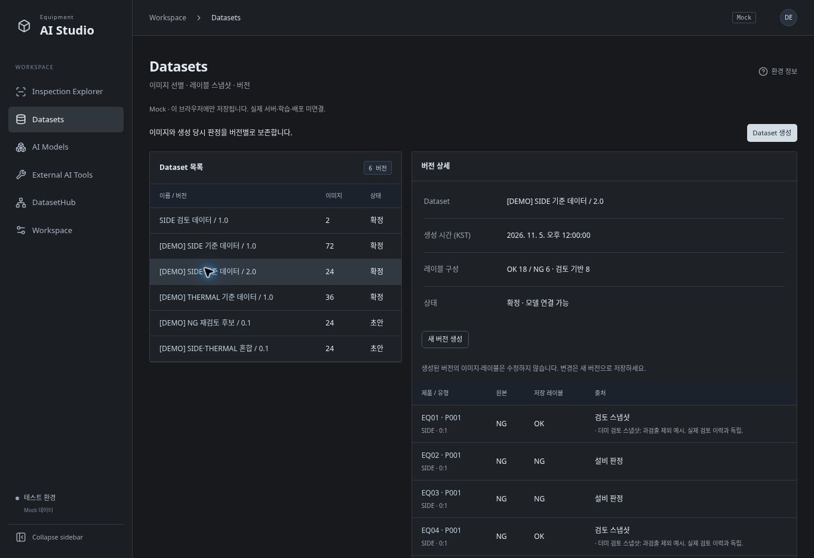

# EquipmentAIStudio 상세 사용 설명서

대상: Frontend Prototype v0.1 / Phase 1~6. Windows 사용자를 위한 실행·화면·시연 안내입니다.

> **현재는 Mock 프론트엔드입니다.** 실제 설비 연결, DatasetHub API, 이미지 Export, SAIGE 실행, 모델 학습·배포는 연결되지 않았습니다. 모든 `[DEMO]` 수치·판정·경로는 합성 예시입니다.

## 1. 설치와 실행

1. Node.js 24 LTS를 설치합니다. Visual Studio C# 컴파일이나 `.sln` 실행은 필요 없습니다.
2. `feat/studio-phase5-6-management` 브랜치의 소스를 clone하거나 ZIP으로 내려받아 압축을 풉니다. 아직 main 병합 전이므로 브랜치를 확인하세요.
3. 저장소 맨 위의 **`Start-Studio.bat`**를 더블클릭합니다.
4. 첫 실행에는 npm 패키지를 설치한 뒤 웹을 빌드합니다. 다음부터 의존성이 바뀌지 않았다면 설치를 건너뛰고 최신 소스를 빌드합니다.
5. 자동으로 열린 브라우저에서 `http://localhost:5173/`에 접속합니다.
6. 실행 창을 유지합니다. 종료는 `Ctrl+C` 또는 창 닫기입니다.

첫 패키지 설치에는 인터넷/npm 접근이 필요합니다. 폐쇄망용 설치 패키지 번들은 아직 포함하지 않습니다. 현재 실행기는 해당 PC에서만 접속하는 테스트 서버입니다. PC 여러 대의 공용 웹 서버 운영은 후속 설정이 필요합니다.

명령어 실행:

```powershell
git clone -b feat/studio-phase5-6-management https://github.com/WithMK/EquipmentAIStudio.git
cd EquipmentAIStudio
.\Start-Studio.bat
```

자동화 옵션: `Start-Studio.bat --prepare`는 설치/빌드만, `Start-Studio.bat --no-open`은 브라우저 없이 서버를 실행합니다. 이미 5173 포트를 사용하는 서버가 있으면 자동으로 다른 포트를 쓰지 않고 실패합니다. 기존 창을 종료한 뒤 실행하세요.

## 2. 더미 데이터 구성

### 기본 검사 데이터

- 설비 EQ01~EQ09, LOT 54개, Product 432개.
- 검사 기간: 2026-11-01~11-06. 화면 시간 표시는 KST입니다.
- SIDE/THERMAL 검사, 4분할 제품, 재검사, 이미지 누락 사례를 포함합니다.
- 이미지의 줄무늬/균열/열화상 패턴은 확대·이동 확인용 합성 SVG입니다. 실제 설비 사진이나 온도 측정값이 아닙니다.

### 자동 추가되는 Dataset

| 이름 | 버전 | 이미지 수 | 최초 상태 | 확인할 내용 |
|---|---|---:|---|---|
| `[DEMO] SIDE 기준 데이터` | 1.0 | 72 | 확정 | 9대 설비의 SIDE 이미지, 원본 OK/NG |
| `[DEMO] SIDE 기준 데이터` | 2.0 | 24 | 확정 | 8개 합성 검토 스냅샷 포함, 원본과 최종 레이블 비교 |
| `[DEMO] THERMAL 기준 데이터` | 1.0 | 36 | 확정 | 9대 설비의 THERMAL 이미지 |
| `[DEMO] NG 재검토 후보` | 0.1 | 24 | 초안 | 원본 NG 이미지 선별 |
| `[DEMO] SIDE·THERMAL 혼합` | 0.1 | 24 | 초안 | 유형 혼합과 버전 확정 |

동일 이미지가 여러 Dataset에 들어갈 수 있습니다. Dataset은 파일을 복사한 폴더가 아니라 이미지 ID와 레이블 출처를 보존한 메타데이터 목록입니다.

### 자동 추가되는 모델·도구

| 항목 | 버전 | 연결 Dataset | 상태 / 예시 지표 |
|---|---|---|---|
| `[DEMO] Side detector` | 1.0 | SIDE 1.0 | 개발 / Accuracy 96.2% |
| `[DEMO] Side detector` | 2.0 | SIDE 2.0 | 검증 / Accuracy 98.1% |
| `[DEMO] Thermal detector` | 1.0 | THERMAL 1.0 | 운영 / Accuracy 97.4% |
| `[DEMO] SAIGE AI Tool` | demo-1 | 해당 없음 | 설치 경로·역할 설명 예시 |

**성능 수치는 실제 학습 결과가 아닙니다.** 운영 상태도 표시 예시이며 어떤 설비에도 모델을 배포하지 않습니다. `D:\DemoModels`와 `D:\DemoTools` 경로는 파일 생성/접근 없이 텍스트로만 저장합니다.

### 추가 정책과 기존 데이터 보존

Datasets / AI Models / External AI Tools를 처음 조회할 때 샘플을 한 번 추가합니다. 기존 사용자 Dataset·모델·도구 및 Image Review DB를 지우거나 덮어쓰지 않습니다. 새로고침, 반복 실행, 여러 탭 동시 조회에도 중복 추가하지 않습니다.

같은 이름/버전이 이미 있으면 해당 샘플을 건너뜁니다. 이 경우 실제 샘플 개수는 위 표보다 적을 수 있고, 건너뛴 Dataset의 예제 모델도 생략할 수 있습니다. 최초 추가 완료 표식을 저장하므로 매번 다시 채우지 않습니다.

SIDE 2.0의 검토는 **Dataset 안의 합성 스냅샷**입니다. 실제 Image Review 이력에 임의 검토를 주입하지 않으므로 Viewer에서는 해당 이미지가 미검토로 보이거나 사용자가 저장한 현재 판정이 표시될 수 있습니다. 이것은 Dataset의 과거 레이블과 현재 검토가 별도임을 보여 줍니다.

## 3. 추천 시연 순서 (약 10분)

1. **Datasets** → `[DEMO] SIDE 기준 데이터 / 2.0` 선택. 원본 NG와 저장 레이블 OK, 검토 스냅샷 메모를 확인합니다.
2. **AI Models** → `[DEMO] Side detector / 2.0` 선택. 학습일·성능·경로·평가 조건을 보고 학습 Dataset 링크로 돌아갑니다.
3. **Inspection Explorer**에서 설비 EQ01, LOT `20261101`, Product `P001`로 검색합니다. 제품을 눌러 Viewer로 들어갑니다.
4. SIDE-1을 선택하고 확대/맞춤/NG 표시를 확인합니다. 개발자 검토를 저장합니다.
5. **Datasets → Dataset 생성**에서 검토 완료 필터로 방금 검토한 이미지를 선택합니다. `내 테스트`, `1.0`으로 저장하고 버전을 확정합니다.
6. **AI Models → 모델 버전 등록**에서 `내 테스트 / 1.0`을 선택해 모델 메타데이터를 저장합니다.
7. **DatasetHub**에서 실패 상태 필터 → EQ03 / Side 상세 → 오류를 확인합니다. 시연 시나리오를 복구 후 정상, 연결 불가로 바꿉니다.
8. 새로고침하여 사용자 Dataset·모델·검토가 남아 있는지 확인합니다.

## 4. Inspection Explorer

기본 진입 화면입니다. 검사 시작/종료 일시, 설비, LOT, Product, 유형, 원본 판정 조건으로 검색합니다. 여러 조건은 AND이며 LOT/Product는 대소문자 구분 없는 부분 검색입니다.

- 표는 LOT → Product 계층이며 LOT를 접고 펼칠 수 있습니다.
- 페이지 크기는 **LOT 개수**입니다. 하나의 LOT에 여러 Product가 표시됩니다.
- 컬럼 정렬과 이전/다음 페이지를 사용할 수 있습니다.
- 제품 판정은 선택 유형의 최신 검사 중 하나라도 NG면 NG입니다. 과거 NG 재검 결과가 최신 OK 제품을 NG로 바꾸지는 않습니다.
- 제품 클릭으로 상세 Viewer로 이동합니다. ‘검색 결과로 복귀’는 검색 조건을 보존합니다.
- 현재 검색 판정은 설비 원본 기준입니다. 개발자 검토 필터는 Dataset 생성 화면에서 제공합니다.

## 5. Product Detail / Image Review

좌측 썸네일에서 촬영 위치를 선택하고 전체/SIDE/THERMAL 및 검사 실행을 전환합니다. 재검 이력을 선택해 다른 실행의 이미지를 확인할 수 있습니다.

- `+ / −`: 확대·축소, `맞춤`: 화면에 맞춤, `100%`: 원본 픽셀 배율.
- 드래그 또는 방향키로 이동, `NG 표시`로 원본 NG 위치 표시 전환.
- 누락 이미지에는 누락 안내가 나오며 검토 저장이 제한됩니다.
- 개발자 검토: OK/NG, 불량 유형, 메모를 입력하고 **검토 저장**을 누릅니다. NG는 불량 유형이 필수입니다.
- OK로 바꾸면 불량 유형 선택은 비워집니다. 설비 원본 판정은 바뀌지 않습니다.
- 저장 완료 메시지를 확인하세요. 변경 이력에는 시각·검토자·메모가 누적됩니다.
- 다른 탭이 먼저 저장한 경우 충돌을 알려 줍니다. 입력은 유지되며 ‘다시 불러오기’로 현재 저장값을 확인한 뒤 수정합니다.
- 미저장 상태에서 이미지/화면 이동 시 확인합니다. 브라우저 종료 경고는 브라우저 정책에 따라 생략될 수 있으므로 먼저 저장하세요.

## 6. Dataset 생성과 버전 관리

### 선택·저장

1. **Dataset 생성**을 누르고 이름/버전을 입력합니다.
2. 설비, LOT/Product/촬영 위치, 유형, 레이블, 검토 여부로 후보를 필터링합니다.
3. 체크박스로 1~500개를 선택합니다. 선택은 다른 페이지나 필터로 이동해도 유지됩니다. ‘선택 해제’는 전체 선택을 비웁니다.
4. **선택 이미지로 저장**을 누릅니다. 저장 시 최신 검토값을 스냅샷으로 고정합니다. 검토가 없으면 원본 판정을 사용합니다.
5. 저장된 버전을 선택하여 이미지 수·레이블 구성·출처를 확인합니다.

이미지 누락은 후보에서 제외합니다. 재검사 이미지는 실행 번호별로 포함됩니다. 동일 이미지를 중복 선택해도 한 버전 안에서는 하나만 저장합니다.

### 초안과 확정

- 초안: 등록 완료 상태지만 모델 연결 전입니다.
- 확정: **버전 확정**을 누르면 모델 등록에서 선택할 수 있습니다.
- 초안/확정 모두 이미 저장한 이미지 목록과 레이블은 수정하지 않습니다. 바꾸려면 **새 버전 생성**으로 독립적인 선택과 버전을 저장합니다. 기존 선택 자동 복제는 하지 않습니다.
- 같은 이름+버전은 대소문자/앞뒤 공백을 무시하고 중복을 막습니다. 버전에는 영문·숫자·점·밑줄·하이픈을 사용합니다.
- 원본 이미지/검토가 나중에 바뀌어도 해당 버전의 저장 레이블은 바뀌지 않습니다. 실제 원본 파일 버전 보관/해시 검증까지 구현한 것은 아닙니다.
- 파일 Export, 기존 버전 편집·삭제는 현재 제공하지 않습니다.

## 7. AI Model 관리

**모델 버전 등록**에서 다음 정보를 입력합니다.

| 입력 | 의미 |
|---|---|
| 모델 이름 / 버전 | 같은 모델의 버전을 구분하는 메타데이터 |
| 학습 Dataset | 확정된 버전만 선택 가능 |
| 학습일 | 외부에서 학습한 날짜를 기록 |
| Accuracy (%) | 0~100 사이의 입력 수치, 자동 평가 아님 |
| 평가 조건 / 검증 Dataset | 지표를 해석할 평가 기준·표본 정보 |
| 모델 파일 경로 | 파일 위치를 텍스트로 기록, 존재 여부 검사 없음 |
| 개발 / 검증 / 운영 | 기록용 분류, 상태 선택이 학습·배포를 실행하지 않음 |

저장 후 목록 검색/선택으로 상세를 볼 수 있고 학습 Dataset 링크로 이동할 수 있습니다. 평가 데이터와 조건이 다르면 정확도만으로 모델 우열을 판단하지 마세요. 기존 버전 수정/삭제 대신 새 버전 등록을 사용합니다.

## 8. External AI Tools

도구 이름, 버전, 설치 경로, 메모를 입력하여 저장합니다. 목록에서 다시 확인할 수 있습니다. SAIGE는 별도 PC/프로그램에서 직접 학습하는 역할이며, 이 화면에서 EXE를 실행하거나 모델 학습을 시작하지 않습니다. 예제 버전 `demo-1`은 실제 SAIGE 제품 버전이 아닙니다.

## 9. DatasetHub 관리

| 시나리오 | 예상 표시 |
|---|---|
| 정상 / 지연 / 실패 혼합 | 정상 25, 지연 1, 실패 1, 확인 불가 0 |
| 장애 복구 후 정상 | 정상 27, 지연·실패 0 |
| Hub 연결 불가 | 확인 불가 27, 현재 정상으로 표시하지 않음 |

기준 시각은 **2026-11-05 12:02 KST**입니다. 화면의 30초 자동 새로고침과 상태 새로고침은 동일 고정 샘플을 다시 읽습니다. 현재 시각과 비교해 실제 설비 장애로 판단하면 안 됩니다.

- EQ03 / Side: 공유폴더 접근 거부 및 재시도 대기 예시.
- EQ05 / Thermal: 예정 작업 지연 예시.
- EQ02 / Side: 연결 장애 → 자동 재시도 → 누락 3개 수집 복구 이력 예시.
- 설비/PC 검색, 상태 필터, PC 선택으로 개별 오류·복구 이력을 확인합니다. ‘전체 이력’으로 복귀합니다.
- 시나리오를 바꾸어도 검색/상태 필터는 유지됩니다. 목록이 비면 필터를 ‘전체 상태’로 바꾸세요.
- 연결 불가에서 보이는 마지막 성공 시간은 과거 확인 기록입니다. 현재 공유폴더 접근이나 수집 성공을 뜻하지 않습니다.
- 실제 수집 실행/설정/복구는 DatasetHub Desktop 책임입니다. 웹에서는 원격 명령을 보내지 않습니다.

## 10. 저장 위치·보존·주의사항

| 데이터 | 위치 | 특성 |
|---|---|---|
| 검사 Mock | 소스 코드의 결정적 fixture | 매번 같은 기준 데이터 |
| 개발자 검토 | IndexedDB `equipment-ai-studio-reviews-v1` | 이미지별 변경 이력 |
| Dataset / Model / Tool | IndexedDB `equipment-ai-studio-catalog-v1` | 사용자 등록 + 최초 1회 샘플 |
| Hub 상태 | Mock adapter | 시나리오별 고정 상태, 사용자 저장 아님 |

브라우저 프로필과 **origin(프로토콜+호스트+포트)**별로 저장됩니다. `localhost:5173`과 `127.0.0.1:5173`, 다른 포트는 별도입니다. 같은 origin의 `/`와 `/studio/`는 저장소를 공유합니다.

다른 PC/브라우저에는 자동 공유되지 않습니다. 사이트 데이터 삭제·시크릿 모드 종료·저장소 정리로 사용자 데이터가 사라질 수 있습니다. 일반 종료/서버 재시작은 데이터를 지우지 않습니다. 초기화 버튼/자동 백업/서버 동기화는 아직 없습니다. 새 프로필에서 접속하면 빈 사용자 데이터와 최초 샘플을 별도로 확인할 수 있습니다.

## 11. 문제 해결

| 증상 | 확인 |
|---|---|
| 배치파일에서 Node.js 오류 | Node.js 24 LTS 설치 후 새 창에서 재실행 |
| npm 설치 실패 | 외부 npm 접근, 사내 프록시/정책 확인; 폐쇄망 번들은 별도 필요 |
| 5173 포트 사용 중 | 기존 Studio 실행 창 종료 후 재실행 |
| 화면이 예전 상태 | 최신 기능 브랜치 다운로드 후 배치 재실행, 브라우저 새로고침 |
| 더미 Dataset이 없음 | 최신 브랜치인지, 브라우저 저장소 오류인지 확인. 이름/버전 충돌은 해당 샘플 생략 |
| 검토 완료 이미지가 없음 | `[DEMO]` 스냅샷은 실제 Review 이력이 아님. Viewer에서 직접 저장 후 후보 화면 재진입 |
| 저장 실패 | 브라우저 권한/저장 공간 확인. 오류 메시지 후 입력을 확인하고 재시도 |
| 모델 Dataset 선택 불가 | Dataset 초안을 먼저 확정 |
| 다른 주소에서 저장값이 없음 | 프로필 및 localhost/IP/포트가 이전과 같은지 확인 |
| Hub 날짜가 고정 | 의도된 Mock 관측 시각. 실제 Hub API 미연결 |

## 12. 개발자 참고

- 초기 샘플: `web/src/adapters/mock/catalogFixtures.ts`.
- 1회 추가·중복/기존 데이터 보호: `catalogRepository.ts`의 `sampleVersion` 처리. IndexedDB readwrite transaction에서 수행합니다.
- `createMockServices.ts`에서 샘플 추가를 활성화합니다. 단위 테스트는 옵션으로 비활성화할 수 있습니다.
- 샘플 정의를 수정해도 이미 추가된 기존 사용자 저장소를 자동 덮어쓰지 않습니다. 향후 샘플 업데이트에는 명시적인 마이그레이션이 필요합니다.
- UI는 `CatalogRepository`, `HubRepository`, `ReviewRepository`를 통해 접근합니다. 실제 API와 인증 도입은 별도 구현입니다.

```powershell
cd web
npm run check
npm run build
npm run test:e2e
```

테스트 실행에는 Playwright Chromium 설치가 필요합니다. Windows CI는 두 해상도(1920×1080, 1440×900), 루트와 `/studio/` 경로, 배치 실행을 함께 검증합니다.

## 13. 화면 예시

기존 사용자가 만든 Dataset은 유지되고 `[DEMO]` 버전들이 별도로 추가됩니다. 아래 화면의 6개는 사용자 Dataset 1개와 더미 5개를 함께 표시한 예입니다.


